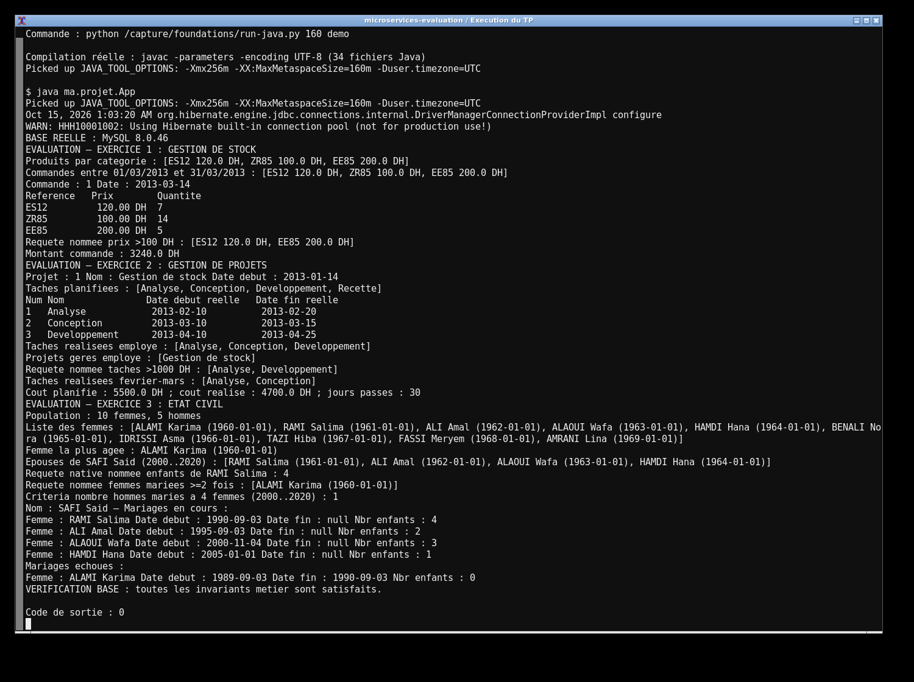
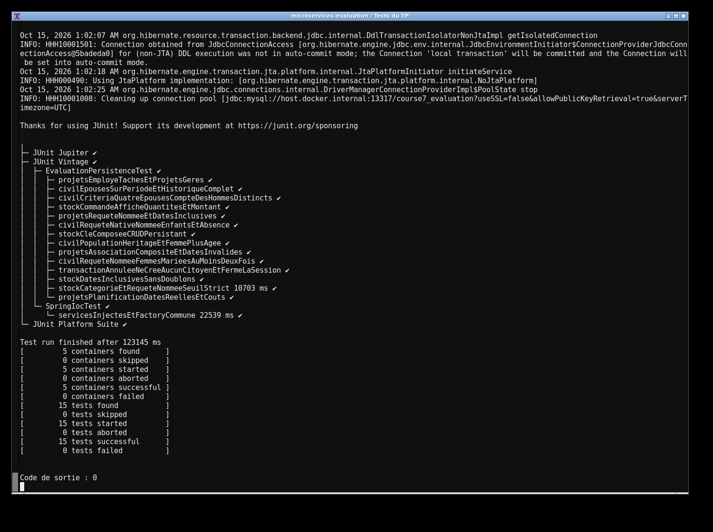

# Évaluation — Spring IoC et Hibernate

J'ai réalisé les trois exercices : gestion de stock, suivi de projets et état civil. Les entités respectent les packages `ma.projet.classes` et `ma.projet.beans`, avec des services dans `ma.projet.service`. Spring IoC instancie les onze services et leur injecte une seule factory Hibernate. Toute la persistance et les tests utilisent MySQL.

J'utilise Java 17 et Maven. Pour lancer le projet :

```sh
docker compose up -d --wait
mvn clean test
mvn exec:java
```

La base `course7_evaluation` est sur 13317 (`root` / `labroot`), configurable avec `DB_URL`, `DB_USER` et `DB_PASSWORD`. Le lancement recrée uniquement le schéma de ce TP. La démonstration affiche les produits et commandes, les tâches et coûts, puis les citoyens et mariages. Elle crée dix femmes et cinq hommes. Les tests couvrent les dates inclusives, les clés composées, les requêtes nommées, la requête native, Criteria, les transactions annulées et le câblage Spring. Les captures proviennent de ces exécutions.

Les captures montrent l'exécution réelle du projet et des tests sur ma machine.



